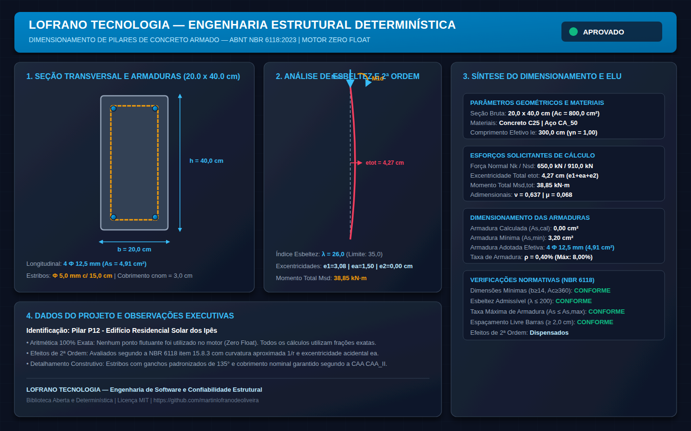

# Dimensionamento e Verificação de Pilares de Concreto Armado (ABNT NBR 6118:2023)

[](https://github.com/martinlofranodeoliveira/dimensionamento-pilares-concreto-nbr6118/actions/workflows/ci.yml)
[](LICENSE)
[](https://www.python.org/)
[](#garantias-técnicas)
[-emerald.svg)](#aritmética-exata-zero-float)
[](https://www.abnt.org.br/)

Motor analítico, determinístico e de código aberto para dimensionamento estrutural, verificação de estabilidade e detalhamento normativo de **pilares de concreto armado** segundo os preceitos rigorosos da **ABNT NBR 6118:2023** (*Projeto de estruturas de concreto - Procedimento*).

Projetado sob a filosofia de engenharia de software de alta confiabilidade da **LOFRANO TECNOLOGIA**, este motor opera com **Zero Float** (100% dos cálculos físicos, geométricos e normativos utilizam frações exatas com `fractions.Fraction` e inteiros), eliminando qualquer erro de arredondamento cumulativo ou imprecisões binárias da norma IEEE-754.

---

## Painel Técnico Vetorial (Renderização 1440x900)

O motor gera automaticamente um painel técnico vetorial SVG em alta resolução contendo a seção transversal cotada (com estribos perimetrais e barras longitudinais com coordenadas exatas), a curva esquemática de deformação com efeitos de 2ª ordem local ($e_1, e_a, e_2, e_{\text{tot}}$) e a memória de cálculo consolidada com selo de aprovação:



---

## Fundamentação Matemática e Formulações Normativas

O pacote implementa o fluxo analítico completo da **ABNT NBR 6118:2023** para elementos lineares submetidos a compressão e flexo-compressão normal:

### 1. Limites Geométricos e Coeficiente de Majoração Adicional $\gamma_n$
Segundo o item 13.2.3 da NBR 6118:2023:
- **Dimensão Mínima Transversal**:
  $$b \ge 14\text{ cm}$$
- **Área Mínima da Seção Bruta**:
  $$A_c = b \cdot h \ge 360\text{ cm}^2$$
- **Majoração Adicional para Seções Esbeltas ($b < 19\text{ cm}$)**:
  Em pilares com dimensão menor que $19\text{ cm}$, as ações solicitantes de cálculo devem ser adicionalmente majoradas pelo coeficiente $\gamma_n$:
  $$\gamma_n = 1{,}95 - 0{,}05 \cdot b \quad (1{,}00 \le \gamma_n \le 1{,}25)$$
  Para $b \ge 19\text{ cm} \implies \gamma_n = 1{,}00$.
  Exemplo: para $b = 14\text{ cm} \implies \gamma_n = 1{,}25$; para $b = 16\text{ cm} \implies \gamma_n = 1{,}15$.

---

### 2. Análise de Esbeltez e Classificação
- **Comprimento Efetivo de Flambagem**:
  $$l_e = \alpha \cdot l$$
  Onde $\alpha = 1{,}0$ para pilares biapoiados.
- **Raio de Giração e Índice de Esbeltez**:
  $$i = \frac{h}{\sqrt{12}} \implies i^2 = \frac{h^2}{12}$$
  $$\lambda = \frac{l_e}{i} = \frac{l_e \cdot \sqrt{12}}{h}$$
- **Limite Máximo Admissível** (Item 15.8):
  Para qualquer elemento estrutural comprimido:
  $$\lambda \le 200$$

---

### 3. Esforços Solicitantes de Cálculo e Excentricidades de 1ª Ordem
- **Força Normal Majorada**:
  $$N_{sd} = \gamma_f \cdot \gamma_n \cdot N_k = 1{,}40 \cdot \gamma_n \cdot N_k$$
- **Excentricidade de 1ª Ordem Primária**:
  $$e_1 = \frac{M_{1d,\max}}{N_{sd}}$$
- **Momento Equivalente de 1ª Ordem** (Item 15.8.2):
  $$M_{1d,A} = \alpha_b \cdot M_{1d,B} \ge 0{,}40 \cdot M_{1d,B}$$
  $$\alpha_b = 0{,}60 + 0{,}40 \cdot \left(\frac{M_{1d,\min}}{M_{1d,\max}}\right) \ge 0{,}40$$
  $$e_{1,A} = \max(\alpha_b \cdot e_1, 0{,}40 \cdot e_1)$$
- **Excentricidade Acidental / Imperfeição Geométrica Local** (Item 11.3.3.4.1):
  $$e_a = \max\left(\frac{l_e}{400}, \frac{h}{30}, 1{,}5\text{ cm}\right) \ge 1{,}5\text{ cm}$$
- **Excentricidade de 1ª Ordem Total**:
  $$e_{1,\text{tot}} = e_{1,A} + e_a$$

---

### 4. Efeitos Locais de 2ª Ordem (Método do Pilar-Padrão com Curvatura Aproximada)
- **Esbeltez Limite $\lambda_1$** (Item 15.8.2):
  $$\lambda_1 = \frac{25 + 12{,}5 \cdot \left(\frac{e_1}{h}\right)}{\alpha_b} \quad \text{com } 35 \le \lambda_1 \le 90$$
  - Se $\lambda \le \lambda_1$: os efeitos locais de 2ª ordem podem ser desprezados ($e_2 = 0$).
  - Se $\lambda > \lambda_1$: cálculo obrigatório de $e_2$ pelo Método da Curvatura Aproximada (Item 15.8.3.3.2):
- **Curvatura Aproximada ($1/r$)**:
  $$\nu = \frac{N_{sd}}{A_c \cdot f_{cd}}$$
  $$\frac{1}{r} = \frac{0{,}005}{h \cdot (\nu + 0{,}5)} \le \frac{0{,}005}{h}$$
- **Excentricidade de 2ª Ordem Local**:
  $$e_2 = \frac{l_e^2}{10} \cdot \left(\frac{1}{r}\right)$$
- **Excentricidade Total e Momento de Projeto**:
  $$e_{\text{tot}} = e_{1,\text{tot}} + e_2$$
  $$M_{sd,\text{tot}} = N_{sd} \cdot e_{\text{tot}}$$

---

### 5. Dimensionamento à Flexo-Compressão Normal no ELU
- **Parâmetros Adimensionais**:
  $$\nu = \frac{N_{sd}}{b \cdot h \cdot f_{cd}}, \quad \mu = \frac{M_{sd,\text{tot}}}{b \cdot h^2 \cdot f_{cd}}$$
- **Área de Aço Calculada ($A_{s,\text{cal}}$)**:
  Obtida analiticamente a partir do equilíbrio da seção transversal com armadura simétrica em duas faces ($A_{s1} = A_{s2} = A_s / 2$):
  $$A_s = \omega \cdot \frac{A_c \cdot f_{cd}}{f_{yd}}$$
- **Armadura Mínima de Pilares** (Item 17.3.5.3):
  $$A_{s,\min} = \max\left(0{,}15\% \cdot \frac{N_{sd}}{f_{yd}}, 0{,}40\% \cdot A_c\right)$$
- **Armadura Máxima**:
  $$A_{s,\max} \le 0{,}08 \cdot A_c = 8\% \cdot A_c \quad (\text{com emenda})$$
  $$A_{s,\text{adotado}} = \max(A_{s,\text{cal}}, A_{s,\min})$$

---

### 6. Detalhamento Normativo das Armaduras
- **Armadura Longitudinal** (Item 18.4.2):
  - Diâmetro mínimo: $\phi_l \ge 10\text{ mm}$.
  - Quantidade mínima: $4$ barras (uma em cada vértice).
  - Espaçamento livre entre barras: $s_{\text{livre}} \ge \max(2\text{ cm}, \phi_l, 1{,}2 \cdot d_{\max})$.
  - Espaçamento máximo entre eixos de barras: $s_{\text{eixos}} \le \min(2 \cdot b, 40\text{ cm})$.
- **Estribos Transversais** (Item 18.4.3):
  - Diâmetro mínimo: $\phi_t \ge \max(5\text{ mm}, \phi_l / 4)$.
  - Espaçamento máximo: $s_{\max} \le \min(20\text{ cm}, b, 12 \cdot \phi_l)$.

---

## Garantias Técnicas LOFRANO TECNOLOGIA

1. **Aritmética Exata (Zero Float)**: Cálculos contínuos expressos exclusivamente em frações exatas (`fractions.Fraction`) e inteiros.
2. **Codec Canônico JSON**: Rejeição de floats não-canônicos, BOM UTF-8 (`\xef\xbb\xbf` / `\ufeff`), chaves duplicadas e profundidade excessiva (> 32 níveis).
3. **Segurança CSV**: Sanitização ativa contra injeção de fórmulas (`=`, `+`, `-`, `@`, `\t`, `\r`).
4. **Painel SVG Vetorial 1440x900**: Representação da seção com cotas, estribos, barras detalhadas e curva deformada com $e_{\text{tot}}$.
5. **Captura Headless Chrome**: Validação visual automatizada gerando `docs/exemplo.png`.
6. **Empacotamento ZIP Determinístico**: Geração byte-a-byte reproduzível com timestamp fixo (`2026-01-01 00:00:00`) e flags seguras `os.O_EXCL | os.O_CREAT`.
7. **Suíte Completa com 56+ Testes**: Testes unitários com validação analítica completa.
8. **Auditor Independente em SQLite (`tools/verify_independent.py`)**: Script autônomo que valida os cálculos em banco `:memory:` sem importar o código de produção.
9. **CI Multiplataforma**: Execução em Linux (Python 3.11, 3.12, 3.13, 3.14) e Windows (Python 3.14) com isolamento total de rede (`unshare -r -n`).

---

## Estrutura do Repositório

```
dimensionamento-pilares-concreto-nbr6118/
├── .github/
│   └── workflows/
│       └── ci.yml               # Workflow de Integração Contínua Multiplataforma
├── docs/
│   ├── exemplo.svg              # Painel técnico vetorial SVG
│   └── exemplo.png              # Captura rasterizada em 1440x900
├── examples/
│   ├── pilar_intermediario_esbeltez_moderada.json
│   └── pilar_canto_alta_carga_fita.json
├── scripts/
│   ├── generate_assets.py       # Gerador determinístico de assets e checksums
│   └── check_distribution.py   # Verificador de integridade do pacote
├── src/
│   └── pilares_concreto_nbr6118/
│       ├── __init__.py
│       ├── py.typed             # Marcador de tipagem PEP 561
│       ├── constants.py         # Constantes, tabelas CAA, concretos e bitolas
│       ├── models.py            # Dataclasses de entrada e saída
│       ├── calculator.py        # Motor analítico exato (Zero Float)
│       ├── codecs.py            # Serializador/Desserializador canônico
│       ├── exporters.py         # Exportadores de memorial e planilha sanitizada
│       ├── svg_generator.py     # Gerador do painel técnico SVG
│       └── cli.py               # Interface de linha de comando (CLI)
├── tests/                       # 56+ testes unitários rigorosos
│   ├── test_constants.py
│   ├── test_models.py
│   ├── test_calculator.py
│   ├── test_codecs.py
│   ├── test_exporters.py
│   ├── test_svg_generator.py
│   ├── test_cli.py
│   └── test_packaging.py
├── tools/
│   └── verify_independent.py   # Auditor independente em SQLite
├── LICENSE                      # Licença MIT
├── pyproject.toml               # Configuração do pacote e metadados de build
└── README.md                    # Documentação técnica em Português
```

---

## Instalação e Requisitos

- Python 3.11 ou superior.
- **Zero dependências externas de terceiros** (somente biblioteca padrão do Python).

```bash
git clone https://github.com/martinlofranodeoliveira/dimensionamento-pilares-concreto-nbr6118.git
cd dimensionamento-pilares-concreto-nbr6118
pip install .
```

---

## Uso da Interface de Linha de Comando (CLI)

O pacote expõe o comando `pilares-concreto`:

### 1. Dimensionamento via Arquivo JSON
```bash
pilares-concreto dimensionar \
  --arquivo examples/pilar_intermediario_esbeltez_moderada.json \
  --relatorio memorial.txt \
  --json-saida resultado.json \
  --csv planilha.csv \
  --svg painel.svg
```

### 2. Dimensionamento Rápido via Argumentos
```bash
pilares-concreto dimensionar \
  --b 20 \
  --h 40 \
  --l 300 \
  --nk 650 \
  --mk-topo 20 \
  --mk-base 15 \
  --fck 25 \
  --caa CAA_II
```

### 3. Consulta de Tabelas Normativas e Materiais
```bash
pilares-concreto tabelas
pilares-concreto materiais
```

---

## Uso Programático (API Python)

```python
from fractions import Fraction
from pilares_concreto_nbr6118 import (
    GeometriaPilar,
    EsforcosPilar,
    PropriedadesMateriais,
    ProjetoPilar,
    dimensionar_pilar_concreto,
    gerar_relatorio_memorial,
)

geometria = GeometriaPilar(
    largura_b_cm=Fraction(20, 1),
    comprimento_h_cm=Fraction(40, 1),
    altura_livre_l_cm=Fraction(300, 1),
)

esforcos = EsforcosPilar(
    forca_normal_nk_kn=Fraction(650, 1),
    momento_topo_mk_topo_knm=Fraction(20, 1),
    momento_base_mk_base_knm=Fraction(15, 1),
)

materiais = PropriedadesMateriais(
    classe_concreto_fck=25,
    classe_agressividade="CAA_II",
)

projeto = ProjetoPilar(
    geometria=geometria,
    esforcos=esforcos,
    materiais=materiais,
    identificacao="Pilar P12",
)

resultado = dimensionar_pilar_concreto(projeto)

print(f"Esbeltez lambda: {resultado.esbeltez.indice_esbeltez_lambda}")
print(f"Momento Total Msd: {resultado.excentricidades.momento_calculo_total_msd_knm} kN·m")
print(f"Armadura: {resultado.detalhamento.quantidade_barras} Φ {resultado.detalhamento.bitola_longitudinal_mm} mm")
print(f"Status Geral: {'APROVADO' if resultado.atende_geral else 'REPROVADO'}")
```

---

## Licença

Distribuído sob os termos da [Licença MIT](LICENSE). Engenharia aberta, acessível e confiável.
